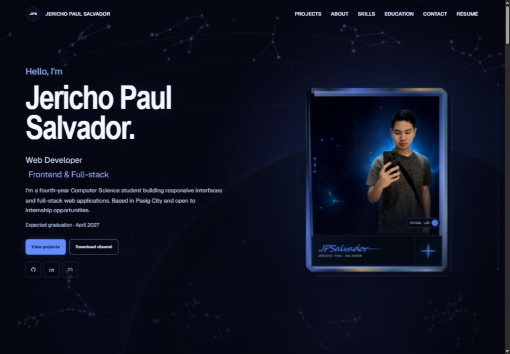

# Jericho Salvador — Frontend & Full-stack Portfolio

[](https://github.com/JcoDonut08/Portfolio/actions/workflows/portfolio-checks.yml)

A celestial-themed internship portfolio for Jericho Salvador, a fourth-year Computer Science student building frontend and full-stack web applications.

Live portfolio: [jcoportfolio.vercel.app](https://jcoportfolio.vercel.app).



## Highlights

- Animated constellation signature opening sequence
- Responsive project grid with directly accessible case-study pages
- Active-section navigation for desktop and mobile
- Interactive 3D technology orbit with keyboard support
- Animated, reversible celestial identity card
- AgriFarm, GabayIskolar, Loveby Ade, and Saan Tayo? with supplied roles and repository links
- Genuine repository interface images, published demo links, and explicit prototype scope
- Project experience, grouped skills, and recruitment contact options
- Accessible contact form with inline validation and clear status messages
- Custom unavailable, not-found, and application error pages
- Social-sharing metadata and a branded preview image
- Reduced-motion, keyboard, and mobile-responsive support

## Technology

- Next.js 15 and React 19
- TypeScript
- React Three Fiber, Drei, and Three.js
- Motion
- Tailwind CSS and modular CSS
- Resend for contact email delivery
- Cloudflare Turnstile for bot protection
- Upstash Redis for distributed rate limiting
- Playwright for end-to-end testing
- GitHub Actions for continuous verification

## Local development

### Requirements

- Node.js 22
- npm

Install the locked dependencies:

```bash
npm ci
```

Copy `.env.example` to `.env.local` if you want to test the contact service, then start the development server:

```bash
npm run dev
```

Open [http://localhost:3000](http://localhost:3000).

The portfolio interface can run locally without production contact credentials. Local contact rate limiting uses a bounded in-memory fallback, but email delivery and Turnstile require their corresponding credentials.

## Environment variables

Never commit real keys or tokens. Store local values in `.env.local` and production values in the Vercel project settings.

| Variable | Production | Purpose |
| --- | --- | --- |
| `RESEND_API_KEY` | Required | Authorizes server-side contact email delivery. |
| `CONTACT_TO_EMAIL` | Required | Receives new portfolio inquiries. |
| `CONTACT_FROM_EMAIL` | Required | Verified sender used by Resend. |
| `NEXT_PUBLIC_TURNSTILE_SITE_KEY` | Required | Public Turnstile widget key. |
| `TURNSTILE_SECRET_KEY` | Required | Server-only Turnstile verification key. |
| `TURNSTILE_ALLOWED_HOSTNAMES` | Required | Comma-separated hostnames allowed to submit the form. |
| `UPSTASH_REDIS_REST_URL` | Required | Upstash Redis REST endpoint for shared rate limits. |
| `UPSTASH_REDIS_REST_TOKEN` | Required | Server-only Upstash REST token. |
| `NEXT_PUBLIC_SITE_URL` | Recommended | Production URL used for canonical and social metadata. |
| `CONTACT_ALLOWED_ORIGINS` | Recommended | Additional custom or preview origins allowed to call the contact API. |

For initial Resend testing, `onboarding@resend.dev` can deliver only to the email associated with the Resend account. Verify a sending domain before delivering to other recipients.

## Contact security

The `/api/contact` route applies layered protection:

- Server-side validation and request-size limits
- Origin checks for cross-site request protection
- Escaped user content before email HTML is generated
- Honeypot spam detection
- Cloudflare Turnstile token and hostname verification
- Durable per-IP, per-email, and global sliding-window limits through Upstash
- Fail-closed production behavior when Turnstile or Upstash is unavailable
- Content Security Policy and restrictive browser security headers

No website can be guaranteed impossible to attack. These controls reduce common risks, while secrets must remain in the deployment provider rather than the repository.

## Quality checks

```bash
npm run lint
npm run build
npm run test:e2e
```

The Playwright suite verifies:

- Opening-sequence handoff, skip control, and immediate deep-link access
- Project navigation and active-section state
- Mobile navigation behavior
- Accessible contact validation
- Error-page return behavior
- Horizontal overflow from 320px phones through tablet and desktop widths
- Shareable case-study navigation, all four project pages, and reduced-motion access

Playwright starts a temporary development server during `npm run test:e2e`. To list the tests without starting a server, run:

```bash
npm run test:e2e:list
```

Every push to `main` and every pull request runs dependency installation, linting, a production build, and the browser suite through GitHub Actions.

## Deploying to Vercel

1. Import this GitHub repository into Vercel.
2. Keep the detected Next.js framework and standard build settings.
3. Use Node.js 22 for consistency with continuous integration.
4. Add the production environment variables listed above.
5. Include the Vercel hostname and custom domain in the Turnstile widget configuration and the allowed-hostname variables.
6. Deploy again after adding or changing environment variables.

The application does not require a `vercel.json` file. Without the production contact credentials, the visual portfolio can deploy, but the contact API intentionally returns an unavailable response.

## Project structure

```text
src/app/          Pages, metadata, error boundaries, and the contact API
src/components/   Portfolio sections and reusable interface components
src/data/         Project content
src/hooks/        Navigation and scroll-reveal behavior
src/lib/          Contact security, email, and shared site utilities
src/styles/       Section-focused responsive styles
e2e/              Playwright browser tests
public/assets/    Profile, project, résumé, and social-preview assets
```

## Attribution

The zodiac field adapts astronomical geometry and Western constellation line conventions from Marc van der Sluys's [ConstellationLines](https://github.com/MarcvdSluys/ConstellationLines) dataset under [CC BY 4.0](https://creativecommons.org/licenses/by/4.0/). See [ATTRIBUTIONS.md](./ATTRIBUTIONS.md) for details.

## Author

Jericho Salvador — Web Developer, Frontend & Full-stack

- [GitHub](https://github.com/JcoDonut08)
- [LinkedIn](https://www.linkedin.com/in/jericho-salvador-986a89432/)
- [Email](mailto:jerichosalvador08@gmail.com)
